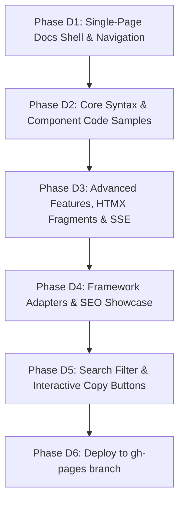

# RHUI Documentation Portal — Master Plan & Content Blueprint

> **Status:** Architecture & Content Blueprint  
> **Target Branch:** `gh-pages`  
> **Output URL:** `https://suserc0de.github.io/rhui/`  
> **Framework:** HTML5 + TailwindCSS + Alpine.js (Lightweight interactive docs SPA) + Prism.js (Syntax Highlighting) + Lucide Icons  
> **Prinsip Utama:** Comprehensive, live executable code examples for every single feature, responsive layout, search/filter capability, and copy-paste ready.

---

## 1. Visi & Tujuan Dokumentasi Web

Tujuan utama dari portal dokumentasi ini adalah menyajikan **dokumentasi kelas dunia (*production-grade docs*)** yang setara dengan TailwindCSS, Astro, Svelte, atau Vue.

Setiap fitur dalam RHUI—dari deklarasi komponen hingga Server-Sent Events—harus memiliki:
1. **Penjelasan Konseptual:** Mengapa fitur ini ada dan bagaimana cara kerjanya.
2. **Kode Contoh Lengkap:**
   - Template `.rhui` (Definisi & Penggunaan).
   - Backend Go (Handler & Data passing).
   - Output HTML yang dihasilkan browser.
3. **Interactive Tabs / Copy Button:** Memudahkan developer langsung copy-paste ke proyek mereka.
4. **Best Practices & Gotchas:** Panduan performa dan keamanan.

---

## 2. Arsitektur UX/UI & Layout Portal

```
+-----------------------------------------------------------------------------------+
|  [Logo] RHUI Docs          [Search Bar (Ctrl+K)]          [GitHub] [Theme] [Donate]|
+-----------------+-------------------------------------------------+---------------+
|  SIDEBAR NAV    |  MAIN CONTENT AREA                              |  ON THIS PAGE |
|                 |                                                 |  (TOC)        |
|  - Getting Start|  # Feature Title                                |               |
|  - Components   |  Badge: v1.0.0 | Difficulty: Beginner           |  - Overview   |
|  - Syntax Guide |  Conceptual overview paragraph...               |  - Template   |
|  - Evaluator    |                                                 |  - Go Handler |
|  - SSE Realtime |  [Tab: .rhui Template] [Tab: Go Code] [Output]  |  - HTML Result|
|  - Adapters     |  ```html                                        |  - Caveats    |
|  - SEO Package  |  <ui:Card title="Analytics">...</ui:Card>       |               |
|  - Advanced v2  |  ```                                            |               |
|                 |                                                 |               |
+-----------------+-------------------------------------------------+---------------+
```

### Karakteristik UI:
- **Left Sidebar:** Hierarki navigasi multi-level (sticky scroll).
- **Center Canvas:** Area konten dokumentasi dengan typography `prose` yang elegan dan code block gelap bertema GitHub Dark.
- **Right Sidebar (On this page):** Table of Contents (TOC) otomatis melacak posisi scroll pembaca.
- **Mobile Drawer:** Menu hamburger responsif yang mulus di perangkat layar sentuh.
- **Copy-to-Clipboard:** Setiap blok kode memiliki tombol 1-klik salin dengan feedback visual.

---

## 3. Matriks Konten & Silabus Fitur yang Wajib Terdokumentasi

Berikut daftar bab dan sub-bab dengan rincian kode contoh yang akan disajikan di dokumentasi:

### Bagian 1: Getting Started
1. **Introduction & Motivation:** Mengapa RHUI dibuat? Masalah yang diselesaikan dibandingkan `html/template` dan `a-h/templ`.
2. **Installation & Setup:** `go get github.com/coderhaqi/rhui`, konfigurasi Go 1.26+, inisialisasi engine.
3. **VS Code Extension Setup:** Panduan syntax highlighting untuk `.rhui` via symlink dan `.vsix`.
4. **Project Structure Best Practices:** Konvensi peletakan folder `templates/components`, `templates/layouts`, dan `templates/pages`.

### Bagian 2: The Component Model
5. **Component Definition (`<component name="...">`):**
   - Mendeklarasikan tag `<component>`.
   - Blok `<props>` dengan atribut `name`, `type`, dan `default`.
   - File mandiri vs pemanggilan berulang.
6. **Props Passing & Dynamic Binding (`:prop` vs `prop`):**
   - String literal `prop="literal"`.
   - Binding ekspresi Go `:prop="Expr"`.
   - Boolean attribute handling (`:disabled="false"` meniadakan atribut).
7. **Slots System:**
   - **Default Slot (`<slot />`):** Menyisipkan konten child umum.
   - **Fallback Slot Content (`<slot>Default</slot>`):** Menampilkan konten bawaan jika slot tidak diisi oleh pemanggil.
   - **Named Slots (`<slot:header>`, `<slot:footer>`):** Komposisi multi-slot pada komponen kompleks (Modal, Layout, Card).
   - **Conditional Slot Rendering (`has_slot('actions')`):** Mencegah wrapper HTML kosong jika slot tidak disediakan.
8. **Dynamic Attribute Spreading (`:attrs="extra_attrs"`):**
   - Meneruskan atribut arbitrer (`id`, `class`, `aria-*`, `hx-*`) ke elemen target di dalam komponen wrapper.

### Bagian 3: Syntax & Template Directives
9. **Conditionals (`<if>` & `<else>`):**
   - Sintaks `<if test="Condition">`.
   - Pasangan blok `<else>`.
   - Pengondisian bersarang (*nested conditionals*).
10. **Loops & Iteration (`<each>`):**
    - Sintaks `<each items="Collection" as="item" index="idx">`.
    - **Loop Context Metadata:** Menggunakan `@index`, `@count`, `@first`, `@last`, `@even`, dan `@odd` untuk zebra-striping tabel.
11. **Text Interpolation & Escaping (`{{ ... }}`):**
    - Akses data struct, map, dan slice.
    - Contextual HTML escaping otomatis untuk mencegah serangan XSS.
12. **Pipe Filters (`{{ Value | Filter }}`):**
    - Built-in filters: `upper`, `lower`, `trim`, `rupiah`, `default(...)`, `dateFormat(...)`, `json`.
    - Mendaftarkan custom filter via `engine.RegisterFilter`.

### Bagian 4: Engine Architecture & Performance
13. **Single Static Binary with `embed.FS`:**
    - Membungkus template ke dalam binary Go via `rhui.WithFS(embeddedFS)`.
14. **Layout Wrapper (`RenderWithLayout`):**
    - Menghindari duplikasi boilerplate `<Layout>` dengan otomatis menyuntikkan halaman ke slot default layout.
15. **Hot-Reload Development Mode (`WithDevMode(true)`):**
    - Live refresh template tanpa restart server Go.
16. **High-Performance Memory Pooling (`sync.Pool`):**
    - Penjelasan arsitektur zero/low allocation di bawah traffic tinggi.

### Bagian 5: Realtime SSR & Server-Sent Events (SSE)
17. **Event-Driven Architecture Overview:** Mengapa SSE + HTML Fragment lebih efisien daripada JSON + WebSocket.
18. **SSE Broker (`rhui/sse`):**
    - Mengelola koneksi klien dengan `broker.Connect`.
    - Mem-broadcast render komponen ke seluruh klien: `broker.BroadcastComponent`.
19. **Integrasi dengan HTMX (`hx-ext="sse"`):**
    - Contoh kode real-time push notification toast.
    - Contoh live counter dan activity feed.

### Bagian 6: Framework Adapters (Cookbook)
20. **Gin Framework Adapter:** `adapter/gin` (`r.HTMLRender`).
21. **Echo Framework Adapter:** `adapter/echo` (`e.Renderer`).
22. **Fiber Framework Adapter:** `adapter/fiber` (`fiber.Views`).
23. **Chi Router & `net/http`:** `adapter/chi` & `adapter/nethttp`.

### Bagian 7: SEO & Meta Tag Management
24. **XML Sitemap Generator:** Membangun `sitemap.xml` dinamis dari database.
25. **Schema.org Structured Data (`JSON-LD`):** Menghasilkan script metadata mesin pencari yang aman.

---

## 4. Pembagian Fase Implementasi Dokumentasi (Execution Phases)



---

### Phase D1: Docs Shell, Layout & Sticky Navigation
* **Tujuan:** Membuat kerangka layout responsif 3-kolom di `index.html` (branch `gh-pages`) dengan TailwindCSS.
* **Luaran:**
  - Sidebar kategori dengan link anchor.
  - Header dengan pencarian cepat, GitHub icon, dan PayPal badge.
  - On-page Table of Contents (TOC).

### Phase D2: Core Component & Syntax Documentation with Code Blocks
* **Tujuan:** Menulis bab panduan komponen, props, default slots, named slots, conditional fallback, dan loop metadata.
* **Luaran:**
  - Setiap topik memiliki tab: `.rhui Template`, `Go Handler`, dan `Browser Output`.
  - Blok kode dengan Prism.js / dark syntax styling yang jelas.

### Phase D3: Advanced Features, HTMX Fragments & Live SSE Streaming
* **Tujuan:** Mendokumentasikan fitur-fitur mutakhir (Pipe filters, HTMX partial fragments, Server-Sent Events broker).
* **Luaran:**
  - Diagram visual arsitektur SSE.
  - Panduan implementasi step-by-step HTMX push notification.

### Phase D4: Multi-Framework Integration Cookbook & SEO
* **Tujuan:** Dokumentasi siap pakai untuk Gin, Echo, Fiber, Chi, net/http, serta XML Sitemap.
* **Luaran:**
  - 4 tab perbandingan framework dengan kode *copy-paste ready*.
  - Panduan SEO Schema.org JSON-LD.

### Phase D5: Live Client Search & Interactive Polish
* **Tujuan:** Menambahkan fitur pencarian instan (filter daftar bab) menggunakan Alpine.js / vanilla JS, serta tombol copy-to-clipboard dengan animasi tooltip.
* **Luaran:**
  - Pengalaman navigasi cepat tanpa reload halaman.

### Phase D6: Review, Build & Git Push ke Branch `gh-pages`
* **Tujuan:** Memvalidasi seluruh tampilan di mobile, tablet, dan desktop, lalu meng-commit ke branch `gh-pages`.

---

## 5. Definition of Done (DoD) Dokumentasi

1. [ ] Dokumentasi mencakup **seluruh 12 fitur RHUI** tanpa ada yang terlewat.
2. [ ] Setiap fitur memiliki minimal **satu contoh kode template `.rhui`** dan **satu contoh handler Go**.
3. [ ] Tampilan 100% responsif pada layar smartphone (375px), tablet (768px), dan desktop (1280px+).
4. [ ] Sintaks kode berwarna kontras dan mudah dibaca (Dark theme).
5. [ ] Fitur salin kode (copy button) berfungsi dengan lancar.
6. [ ] Berkas tersimpan rapi di branch `gh-pages` dan siap diakses publik via GitHub Pages.
