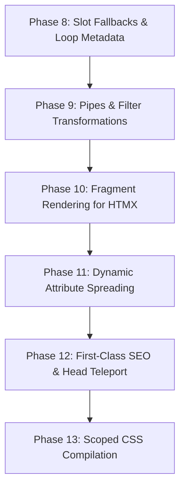

# RHUI v2 — Advanced Features Master Plan & Execution Roadmap

> **Status:** Architecture Blueprint & Phase Breakdown for Next-Gen Features  
> **Target Version:** RHUI v1.1.0 – v2.0.0  
> **Target Runtime:** Go 1.26+  
> **Fokus Utama:** Developer Experience (DX), Scoped Components, Advanced Rendering for HTMX, Form Handling, and Pipes/Filters.

---

## 1. Visi Pengembangan Lanjutan

RHUI telah berhasil membuktikan arsitektur inti:
- Lexer & Recursive-Descent Parser berbasis `.rhui`
- Reusable Component Registry & Hierarchical Slots
- Contextual HTML Escaping & XSS Security
- Multi-framework Adapters (Gin, Echo, Fiber, Chi, net/http)
- Realtime Live Component Streaming via Server-Sent Events (`sse/`)
- Embed.FS & `sync.Pool` Buffer Optimization

Fase pengembangan lanjutan ini bertujuan melengkapi RHUI dengan fitur-fitur modern setara framework frontend populer (Vue/Svelte/Astro), namun tetap mempertahankan **prinsip Server-Side Rendering murni (100% Go, zero JS build step)**.

---

## 2. Rincian Fitur Tingkat Lanjut (Detailed Specifications)

### 2.1 Fallback Slot Content (Default Slot Content)
Komponen dapat mendefinisikan konten fallback di dalam tag slot. Jika pemanggil tidak mengisi slot tersebut, konten fallback yang akan dirender secara otomatis.

**Sintaks:**
```html
<component name="Card">
  <div class="card">
    <div class="card-body">
      <slot>
        <p class="text-muted">Konten belum tersedia.</p>
      </slot>
    </div>
    <div class="card-footer">
      <slot:footer>
        <small class="text-secondary">&copy; 2026 Default Footer</small>
      </slot:footer>
    </div>
  </div>
</component>
```

---

### 2.2 Template Pipe Filters (`{{ Value | Filter }}`)
Mendukung transformasi tampilan nilai langsung di dalam interpolasi menggunakan operator pipe `|`, lengkap dengan argumen opsional.

**Sintaks:**
```html
<p>Total: {{ Order.Amount | rupiah }}</p>
<p>Tanggal: {{ Order.CreatedAt | dateFormat("02 Jan 2006") }}</p>
<p>Nama: {{ User.Name | trim | upper }}</p>
```

**Filter Bawaan (Built-in Filters):**
- `upper` / `lower` / `title`: Manipulasi huruf besar/kecil.
- `trim`: Menghilangkan whitespace.
- `dateFormat(layout)`: Format `time.Time` Go.
- `rupiah` / `currency(symbol)`: Format angka ke mata uang.
- `default(fallbackVal)`: Memberikan nilai pengganti jika nil atau string kosong.
- `json`: Serialisasi data Go ke string JSON yang di-escape aman.

---

### 2.3 Loop Context Metadata (`@first`, `@last`, `@index`, `@even`, `@odd`)
Di dalam tag `<each items="..." as="...">`, engine otomatis menyuntikkan variabel lokal loop ke dalam scope:

| Variabel | Tipe | Penjelasan |
| :--- | :--- | :--- |
| `@index` | `int` | Indeks perulangan (mulai dari 0) |
| `@count` | `int` | Nomor urut perulangan (mulai dari 1) |
| `@first` | `bool` | `true` jika merupakan elemen pertama |
| `@last` | `bool` | `true` jika merupakan elemen terakhir |
| `@even` | `bool` | `true` jika baris genap (`@count % 2 == 0`) |
| `@odd` | `bool` | `true` jika baris ganjil (`@count % 2 != 0`) |

**Sintaks:**
```html
<each items="Users" as="user">
  <tr :class="@even ? 'row-even' : 'row-odd'">
    <td>{{ @count }}</td>
    <td>{{ user.Name }}</td>
    <if test="@last">
      <td><span class="badge">Baris Terakhir</span></td>
    </if>
  </tr>
</each>
```

---

### 2.4 Partial / Fragment Rendering (`RenderFragment`)
Untuk integrasi HTMX atau respons AJAX modular, endpoint server seringkali hanya perlu merender satu fragmen kecil dari sebuah halaman tanpa memproses layout lengkap atau seluruh file.

**Sintaks Template (`pages/users.rhui`):**
```html
<div class="user-page">
  <header>...</header>

  <!-- Fragment target HTMX -->
  <div id="user-table" fragment="table-rows">
    <each items="Users" as="user">
      <ui:UserRow :user="user" />
    </each>
  </div>
</div>
```

**Sintaks Handler Go:**
```go
// Hanya merender node dengan fragment="table-rows"
err := engine.RenderFragment(w, "pages/users", "table-rows", data)
```

---

### 2.5 Scoped CSS & Asset Extractor (`<style scoped>`)
Setiap komponen `.rhui` dapat memiliki tag `<style scoped>`. Saat template dikompilasi, engine:
1. Menghasilkan ID scope acak atau berbasis hash nama komponen (misal: `data-rhui-c8a1`).
2. Menambahkan atribut tersebut ke elemen HTML akar dan child milik komponen.
3. Mentransformasikan CSS selector (misal `.btn` menjadi `.btn[data-rhui-c8a1]`).
4. Menyediakan method `engine.RenderCSS()` untuk mengekstrak seluruh CSS yang terisolasi ke `<head>`.

**Sintaks:**
```html
<component name="Badge">
  <props>
    <prop name="color" default="blue" />
  </props>

  <span class="badge badge-{{ color }}">
    <slot />
  </span>

  <style scoped>
    .badge {
      display: inline-block;
      padding: 4px 8px;
      border-radius: 9999px;
      font-size: 12px;
      font-weight: 600;
    }
    .badge-blue { background: #dbeafe; color: #1e40af; }
  </style>
</component>
```

---

### 2.6 Dynamic Attribute Spreading (`:attrs="ExtraProps"`)
Memungkinkan komponen wrapper meneruskan sekumpulan atribut HTML dinamis (seperti `aria-*`, `data-*`, `hx-get`, `id`) tanpa mendeklarasikannya satu per satu di `<props>`.

**Sintaks:**
```html
<component name="Input">
  <props>
    <prop name="name" />
  </props>

  <!-- Atribut tak terdaftar di props otomatis masuk ke :attrs -->
  <input :name="name" class="form-control" :attrs="extra_attrs" />
</component>

<!-- Pemanggilan -->
<ui:Input name="email" placeholder="user@mail.com" required="true" hx-post="/check" />
```

---

### 2.7 First-Class SEO & Meta-Tag Management (`<Head>`, OpenGraph, & JSON-LD)
Karena RHUI adalah template engine SSR murni, halaman web secara bawaan sudah 100% terbaca oleh web crawler mesin pencari (Googlebot, Bingbot, dll). Namun, untuk **memaksimalkan SEO teknis**, RHUI menyediakan mekanisme first-class untuk mengelola metadata halaman, Canonical URL, OpenGraph/Twitter Cards, dan Schema.org JSON-LD secara terstruktur.

#### A. Komponen Head Portal / Teleport (`<Head>`)
Halaman anak (`pages/article.rhui`) dapat menyuntikkan title, meta description, dan OpenGraph langsung ke bagian `<head>` milik Layout induk tanpa perlu mengotori data props layout.

**Sintaks Halaman (`pages/article.rhui`):**
```html
<Head>
  <title>{{ Article.Title }} | MyBlog</title>
  <meta name="description" :content="Article.Summary" />
  <link rel="canonical" :href="Article.CanonicalURL" />

  <!-- OpenGraph & Social Sharing -->
  <meta property="og:title" :content="Article.Title" />
  <meta property="og:description" :content="Article.Summary" />
  <meta property="og:image" :content="Article.CoverImage" />
  <meta property="og:type" content="article" />
</Head>

<div class="article-content">
  <h1>{{ Article.Title }}</h1>
  <p>{{ Article.Body }}</p>
</div>
```

#### B. SEO Schema Struct & JSON-LD Helper (`schema_jsonld`)
Mendukung generasi otomatis Structured Data Schema.org (Article, Product, Organization, BreadcrumbList) yang valid dan di-escape aman dari script-injection:

```html
<Head>
  <!-- Menghasilkan <script type="application/ld+json">...</script> ter-escape aman -->
  {{ Article.Schema | jsonld }}
</Head>
```

#### C. Sitemap & Robots Generator Helper
Package helper `rhui/seo` untuk menghasilkan XML Sitemap dan `robots.txt` dinamis langsung dari Go:
```go
import "github.com/coderhaqi/rhui/seo"

sitemap := seo.NewSitemap("https://example.com")
sitemap.Add(seo.URL{
    Loc:        "/posts/go-template-engine",
    LastMod:    time.Now(),
    ChangeFreq: "weekly",
    Priority:   0.8,
})
sitemap.Render(w)
```

---

## 3. Pembagian Fase Implementasi (Phase Breakdown)



---

### Phase 8: Slot Fallback Content & Loop Metadata
* **Fokus:** DX Inti pada struktur komponen dan iterasi.
* **Tasks:**
  1. Update parser untuk mendukung children di dalam tag `<slot>` dan `<slot:name>` sebagai fallback nodes.
  2. Update renderer untuk merender fallback nodes saat slot pemanggil kosong.
  3. Update `renderEach` di runtime untuk menyuntikkan variabel `@index`, `@count`, `@first`, `@last`, `@even`, `@odd` ke dalam `loopScope`.
  4. Unit test suite di `tests/slot_fallback_test.go` dan `tests/loop_meta_test.go`.

---

### Phase 9: Pipe Filters & Data Formatting
* **Fokus:** Fleksibilitas formatting nilai di dalam interpolasi.
* **Tasks:**
  1. Perluas Lexer & Tokenizer untuk mendukung operator token pipe `|`.
  2. Implementasikan parsing ekspresi pipe di `runtime/evaluator.go`.
  3. Daftarkan registry built-in filters (`upper`, `lower`, `trim`, `dateFormat`, `rupiah`, `default`, `json`).
  4. Sediakan API pendaftaran filter kustom: `engine.RegisterFilter(name, fn)`.
  5. Unit test suite di `tests/pipe_filter_test.go`.

---

### Phase 10: Fragment / Partial Rendering (HTMX First-Class)
* **Fokus:** Efisiensi rendering respons parsial AJAX / HTMX.
* **Tasks:**
  1. Tambahkan atribut `fragment="..."` pada `ast.ElementNode`.
  2. Parser mencatat dan mengindeks seluruh node ber-fragmen ke dalam metadata template.
  3. Implementasikan fungsi publik `engine.RenderFragment(w io.Writer, templateName, fragmentID string, data any) error`.
  4. Integrasikan helper ke seluruh adapter (`gin`, `echo`, `fiber`, `chi`, `nethttp`).
  5. Unit test suite di `tests/fragment_render_test.go`.

---

### Phase 11: Dynamic Attribute Spreading (`:attrs`)
* **Fokus:** Komponen wrapper generik (Form inputs, custom links).
* **Tasks:**
  1. Pada saat pemanggilan komponen, atribut yang tidak terdaftar di skema `<props>` dikumpulkan ke dalam map `extra_attrs`.
  2. Renderer elemen mendukung atribut khusus `:attrs="mapData"`.
  3. Seluruh key-value map dirender ke tag HTML dengan sanitasi XSS yang tepat.
  4. Unit test suite di `tests/attribute_spread_test.go`.

---

### Phase 12: First-Class SEO & Meta-Tag Management
* **Fokus:** Optimasi mesin pencari, Social Graph, dan Schema.org.
* **Tasks:**
  1. Implementasikan `<Head>` teleport container: node di dalam `<Head>` dikumpulkan dan disuntikkan otomatis ke dalam tag `<head>` layout saat `RenderWithLayout`.
  2. Tambahkan built-in filter `jsonld` untuk memformat Schema.org struct ke `<script type="application/ld+json">` yang aman dari XSS escaping.
  3. Buat package `seo/` berisi generator XML Sitemap (`seo.NewSitemap`) dan generator `robots.txt`.
  4. Unit test suite di `tests/seo_test.go`.

---

### Phase 13: Scoped CSS & Asset Extractor
* **Fokus:** Encapsulation styling komponen.
* **Tasks:**
  1. Parser mendukung tag `<style scoped>` di dalam `<component>`.
  2. Compiler menghasilkan hash identifier unik per komponen (misal: `_rhui_abc123`).
  3. CSS Scoper menambahkan attribute selector ke aturan CSS.
  4. Tambahkan method `engine.RenderCSS(w io.Writer) error` untuk mengekstrak seluruh bundle CSS yang digunakan.
  5. Unit test suite di `tests/scoped_css_test.go`.

---

## 4. Acceptance Criteria & Quality Gates

Setiap fase harus memenuhi standar:
1. **Zero Breaking Changes:** Fitur baru tidak boleh merusak template `.rhui` yang sudah ada.
2. **Race-Detector Clean:** Lulus `go test -count=1 -v -race ./tests/...` tanpa data race.
3. **Memory Allocation Control:** Tidak menurunkan performa benchmark (`BenchmarkEngineRender`) secara signifikan.
4. **Dokumentasi Lengkap:** Pembaruan pada `README.md`, `CHANGELOG.md`, dan contoh aplikasi demo.
